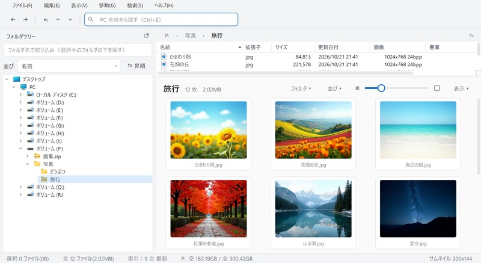
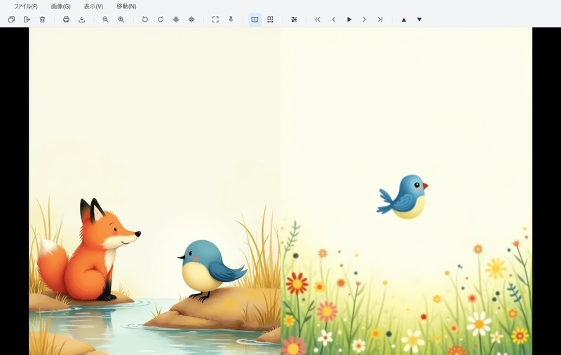
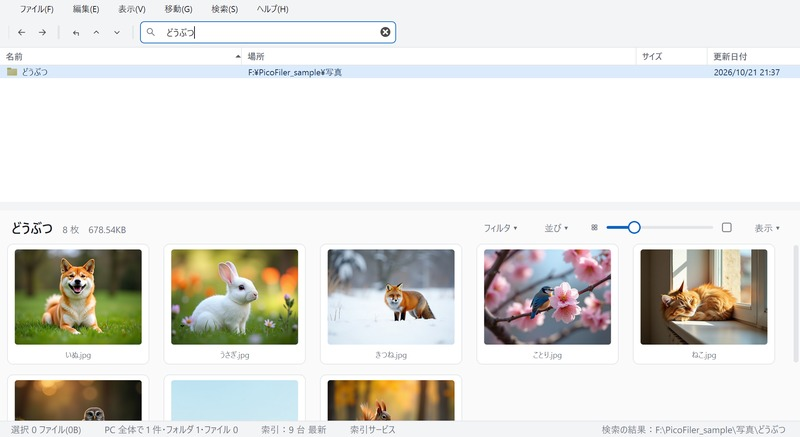

# PicoFiler

**軽くて速い Windows 用の画像ビューア・整理ツール（無料）**
A fast, lightweight image viewer and organizer for Windows (free).



## ダウンロード / Download

👉 **[最新版をダウンロード（Releases）](https://github.com/nanana03/picofiler-release/releases/latest)** — `PicoFiler-<版>-setup.exe`

- 動作環境：Windows 10 / 11（64bit）
- インストールには管理者の権限が必要です（PC 全体の検索を速くする「索引サービス」を登録するため。入れないことも選べます）。
- コード署名をしていないため、「Windows によって PC が保護されました」と表示されることがあります。［詳細情報］→［実行］で進んでください。

winget でも入れられます（登録の手続き中）：

```
winget install Nanana.PicoFiler
```

## できること / Features

- フォルダツリー・ファイルの一覧（サムネイル）・画像を並べて、たくさんの画像を見ながら整理
- JPEG・PNG・GIF・BMP・WebP・TIFF・AVIF・PSD などを表示
- ZIP・7z・RAR・LZH の書庫を、展開せずにフォルダのように開ける
- 見開き表示（右綴じ・1 ページずらして組み直せる）・全画面・スライドショー
- フォルダツリーの並び替えと名前での絞り込み／ツリーを 2 つ以上並べてドラッグで移動・複写
- **PC 全体から名前で一瞬で探す**（索引はこの PC の中だけに保存し、外部へは送りません）
- キーとマウスの割り当て・見た目（3 種類）を設定で変えられる

| 見開き表示 | PC 全体の検索 |
|---|---|
|  |  |

## 料金・寄付 / Donation

PicoFiler は無料です。気に入っていただけたら、寄付で応援していただけるとうれしいです。
PicoFiler is free. If you like it, please consider supporting it.

💝 寄付の方法（Amazon ギフトカードなど）／ How to donate: https://nanana03.github.io/picofiler/#donate

## このリポジトリについて / About this repository

ここは配布物（インストーラー）を置く場所です。PicoFiler 本体のソースコードは公開していません。
同梱しているオープンソースの部品（Qt / PySide6・7-Zip など）のソースは
[nanana03/picofiler-oss-sources](https://github.com/nanana03/picofiler-oss-sources) にあります。
使用許諾は [LICENSE.txt](LICENSE.txt)、部品のライセンスは [THIRD_PARTY_NOTICES.txt](THIRD_PARTY_NOTICES.txt) をご覧ください。

This repository hosts the installer only; the source code of PicoFiler itself is not public.
Sources of the bundled open-source components are in
[nanana03/picofiler-oss-sources](https://github.com/nanana03/picofiler-oss-sources).

## お問い合わせ / Contact

Nanana — nanana03info@gmail.com
